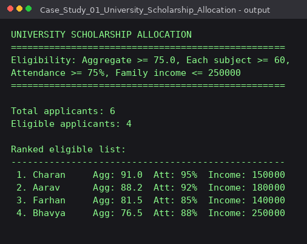

# 1. University Scholarship Allocation

**Student:** Leela Deepak Golukonda  |  **Roll No:** 26000521


## Problem Statement

Design a system that evaluates scholarship applicants using aggregate marks, subject-wise minimum scores, attendance and family-income criteria. The system must rank the eligible students and resolve ties using predefined rules.

## Objectives

- Read applicant records containing marks, attendance and income.
- Check each applicant against all eligibility conditions.
- Collect eligible applicants and rank them by aggregate marks.
- Resolve ties using attendance as a tie-breaker.
- Display a clean ranked scholarship list.

## Assumptions

- Aggregate marks are provided on a 0-100 scale.
- Each applicant has exactly four subject scores.
- Minimum aggregate = 75.0, minimum subject = 60, minimum attendance = 75%.
- Maximum eligible family income = Rs 2,50,000.
- Ranking is by aggregate (desc), then attendance (desc).

## Algorithm

1. START.
2. Define eligibility thresholds (aggregate, subject, attendance, income).
3. Store applicants as a list of tuples (name, aggregate, subjects, attendance, income).
4. FOR each applicant: check aggregate >= min, every subject >= min, attendance >= min, income <= max.
5. IF all conditions satisfy, add applicant to eligible list.
6. Sort eligible list by aggregate descending; use attendance as tie-breaker.
7. Assign rank numbers to the sorted list.
8. PRINT total applicants, eligible count and the ranked list.
9. STOP.

## Flowchart

```
        +------------------+
        |      START       |
        +--------+---------+
                 |
        +--------v---------+
        | Read applicants  |
        | (tuples)         |
        +--------+---------+
                 |
        +--------v---------+
        | FOR each student |
        | check eligibility|
        +--------+---------+
                 |
        +--------v---------+
        | All conditions   |
        | satisfied?       |
        +----+------+------+
           YES      NO
            |        |
        +---v--+  +--v---+
        | Add  |  | Skip |
        | list |  +------+
        +---+--+
            |
        +---v------------------+
        | Sort: agg desc,      |
        | attendance desc       |
        +---+------------------+
            |
        +---v----------+
        | Print ranked |
        | list         |
        +---+----------+
            |
        +---v----+
        | STOP   |
        +--------+
```

## Pseudocode

```
BEGIN ScholarshipAllocation
  SET minAgg = 75.0, minSub = 60, minAtt = 75, maxInc = 250000
  applicants = list of (name, agg, [s1..s4], att, inc)
  eligible = empty list
  FOR each (name, agg, subs, att, inc) IN applicants:
    subOK = TRUE
    FOR s IN subs:
      IF s < minSub THEN subOK = FALSE
    IF agg >= minAgg AND subOK AND att >= minAtt AND inc <= maxInc:
      ADD (name, agg, att, inc) TO eligible
  ranked = SORT eligible BY (agg DESC, att DESC)
  PRINT 'Eligible:', LENGTH(eligible)
  rank = 1
  FOR each e IN ranked:
    PRINT rank, e.name, e.agg, e.att, e.inc
    rank = rank + 1
END
```

## Python Source Code

```python
# University Scholarship Allocation
# Student: Leela Deepak Golukonda | Roll No: 26000521

# Each applicant: (name, aggregate, [sub1, sub2, sub3, sub4], attendance, income)
applicants = [
    ("Aarav", 88.2, [82, 79, 90, 85], 92, 180000),
    ("Bhavya", 76.5, [70, 65, 72, 68], 88, 250000),
    ("Charan", 91.0, [88, 90, 85, 92], 95, 150000),
    ("Divya", 69.0, [60, 58, 62, 55], 80, 120000),
    ("Esha", 84.0, [80, 78, 82, 79], 90, 300000),
    ("Farhan", 81.5, [77, 75, 80, 79], 85, 140000),
]

MIN_AGG = 75.0
MIN_SUB = 60
MIN_ATT = 75
MAX_INCOME = 250000

print("UNIVERSITY SCHOLARSHIP ALLOCATION")
print("=" * 50)
print("Eligibility: Aggregate >= %.1f, Each subject >= %d," % (MIN_AGG, MIN_SUB))
print("Attendance >= %d%%, Family income <= %d" % (MIN_ATT, MAX_INCOME))
print("=" * 50)

eligible = []
for (name, agg, subs, att, inc) in applicants:
    sub_ok = True
    for s in subs:
        if s < MIN_SUB:
            sub_ok = False
    if agg >= MIN_AGG and sub_ok and att >= MIN_ATT and inc <= MAX_INCOME:
        eligible.append((name, agg, att, inc))

# rank by aggregate desc, tie by attendance desc
ranked = sorted(eligible, key=lambda x: (x[1], x[2]), reverse=True)

print("\nTotal applicants:", len(applicants))
print("Eligible applicants:", len(eligible))
print("\nRanked eligible list:")
print("-" * 50)
rank = 1
for (name, agg, att, inc) in ranked:
    print("%2d. %-10s Agg: %.1f  Att: %d%%  Income: %d" % (rank, name, agg, att, inc))
    rank += 1

if len(ranked) == 0:
    print("No eligible candidates found.")

```

## Test Cases

| # | Input / Scenario | Expected Result |
|---|------------------|-----------------|
| 1 | Applicant with agg 88.2, all subs>=60, att 92%, inc 1.8L | Eligible and ranked |
| 2 | Applicant with agg 69.0 (below 75) | Not eligible |
| 3 | Applicant with income 3.0L (above 2.5L) | Not eligible |
| 4 | Two eligible with same aggregate | Tie broken by attendance |

## Output

```
UNIVERSITY SCHOLARSHIP ALLOCATION
==================================================
Eligibility: Aggregate >= 75.0, Each subject >= 60,
Attendance >= 75%, Family income <= 250000
==================================================

Total applicants: 6
Eligible applicants: 4

Ranked eligible list:
--------------------------------------------------
 1. Charan     Agg: 91.0  Att: 95%  Income: 150000
 2. Aarav      Agg: 88.2  Att: 92%  Income: 180000
 3. Farhan     Agg: 81.5  Att: 85%  Income: 140000
 4. Bhavya     Agg: 76.5  Att: 88%  Income: 250000

```



## Conclusion

The program successfully filters eligible candidates using multiple conditions and produces a deterministic ranked list. Tuple unpacking and sorted() made the logic clear and easy to verify.
