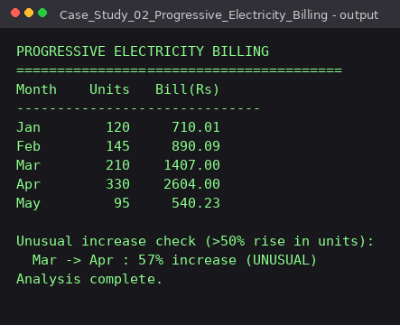

# 2. Progressive Electricity Billing

**Student:** Leela Deepak Golukonda  |  **Roll No:** 26000521


## Problem Statement

Calculate household electricity bills using multiple consumption slabs, fixed charges, surcharges and rebates. Then compare bills across several months and identify unusual increases.

## Objectives

- Apply slab-based unit pricing to consumed units.
- Add a fixed charge to every bill.
- Apply rebate for low consumption and surcharge for high bills.
- Compare monthly consumption to flag unusual increases.

## Assumptions

- Slabs: 0-100 @ Rs5, 101-200 @ Rs7, 201-300 @ Rs9, >300 @ Rs11 per unit.
- Fixed charge = Rs 50 per bill.
- Rebate of 2% if units < 150.
- Surcharge of 5% if final bill > Rs 500.
- An unusual increase is a rise of more than 50% in units month-over-month.

## Algorithm

1. START.
2. Define slab boundaries and rates.
3. FOR each (month, units) in the record:
4.   Compute energy cost by checking which slab the units fall into.
5.   Add fixed charge.
6.   Apply 2% rebate if units < 150.
7.   Apply 5% surcharge if bill > 500.
8.   Round bill and store it.
9. FOR each consecutive pair of months, compute % rise in units.
10.   IF rise > 50%, flag as unusual.
11. PRINT monthly bills and the unusual-increase report.
12. STOP.

## Flowchart

```
        +------------------+
        |      START       |
        +--------+---------+
                 |
        +--------v---------+
        | Read (month,     |
        | units) records   |
        +--------+---------+
                 |
        +--------v---------+
        | FOR each record  |
        +--------+---------+
                 |
        +--------v---------+
        | Find slab &      |
        | compute cost     |
        +--------+---------+
                 |
        +--------v---------+
        | Add fixed charge |
        | rebate/surcharge |
        +--------+---------+
                 |
        +--------v---------+
        | Store bill,      |
        | next record?     |
        +----+------+------+
           YES      NO
            |        |
            |    +---v----------+
            |    | Compare months|
            |    | flag >50% rise|
            |    +---+----------+
            |        |
            +--------v----+
                 | STOP   |
                 +--------+
```

## Pseudocode

```
BEGIN ElectricityBilling
  slabs = [(100,5),(200,7),(300,9),(INF,11)]
  fixed = 50
  FOR (month, units) IN records:
    cost = 0; prev = 0
    FOR (limit, rate) IN slabs:
      IF units > prev:
        cost = cost + (min(units,limit)-prev)*rate
      prev = limit
    bill = cost + fixed
    IF units < 150: bill = bill - bill*0.02
    IF bill > 500: bill = bill + bill*0.05
    store (month, units, round(bill))
  FOR i = 1 TO length(bills)-1:
    rise = (bills[i].units - bills[i-1].units)/bills[i-1].units
    IF rise > 0.5: PRINT 'Unusual:', bills[i-1], bills[i]
END
```

## Python Source Code

```python
# Progressive Electricity Billing
# Student: Leela Deepak Golukonda | Roll No: 26000521

print("PROGRESSIVE ELECTRICITY BILLING")
print("=" * 40)

# Slab rates (Rs per unit)
# 0-100   : 5
# 101-200 : 7
# 201-300 : 9
# >300    : 11
# fixed charge = 50, surcharge 5% if bill>500, rebate 2% if units<150

months = [("Jan", 120), ("Feb", 145), ("Mar", 210), ("Apr", 330), ("May", 95)]

print("%-8s %5s   %8s" % ("Month", "Units", "Bill(Rs)"))
print("-" * 30)
bills = []
for (month, units) in months:
    if units <= 100:
        cost = units * 5
    elif units <= 200:
        cost = 500 + (units - 100) * 7
    elif units <= 300:
        cost = 500 + 700 + (units - 200) * 9
    else:
        cost = 500 + 700 + 900 + (units - 300) * 11
    bill = cost + 50
    if units < 150:
        bill = bill - bill * 0.02
    if bill > 500:
        bill = bill + bill * 0.05
    bill = round(bill, 2)
    bills.append((month, units, bill))
    print("%-8s %5d   %8.2f" % (month, units, bill))

print("\nUnusual increase check (>50% rise in units):")
flagged = False
for i in range(1, len(bills)):
    pu = bills[i - 1][1]
    cu = bills[i][1]
    if pu > 0 and (cu - pu) / pu > 0.5:
        print("  %s -> %s : %.0f%% increase (UNUSUAL)" % (bills[i-1][0], bills[i][0], (cu - pu) / pu * 100))
        flagged = True
if not flagged:
    print("  No unusual increases detected.")
print("Analysis complete.")

```

## Test Cases

| # | Input / Scenario | Expected Result |
|---|------------------|-----------------|
| 1 | Jan 120 units (slab1 + rebate) | Bill ~ Rs 650.00 with rebate |
| 2 | Apr 330 units (slab4 + surcharge) | Bill > Rs 500 with surcharge |
| 3 | Feb 145 -> Mar 210 units (+45%) | Not flagged (below 50%) |
| 4 | Mar 210 -> Apr 330 units (+57%) | Flagged as unusual |

## Output

```
PROGRESSIVE ELECTRICITY BILLING
========================================
Month    Units   Bill(Rs)
------------------------------
Jan        120     710.01
Feb        145     890.09
Mar        210    1407.00
Apr        330    2604.00
May         95     540.23

Unusual increase check (>50% rise in units):
  Mar -> Apr : 57% increase (UNUSUAL)
Analysis complete.

```



## Conclusion

The slab-based billing was implemented with simple if-elif branches. The month-over-month comparison loop cleanly detects abnormal consumption, which is useful for energy monitoring.
