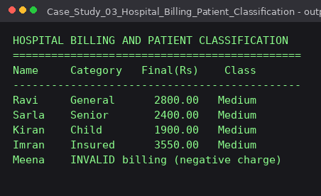

# 3. Hospital Billing and Patient Classification

**Student:** Leela Deepak Golukonda  |  **Roll No:** 26000521


## Problem Statement

Process consultation, diagnostic and treatment charges; apply conditional concessions based on patient category; validate billing constraints; and classify patients according to a payment policy.

## Objectives

- Read patient records with category and three charge components.
- Validate that no charge is negative.
- Apply the correct concession per patient category.
- Classify the final bill as Low / Medium / High.

## Assumptions

- Categories: General (no concession), Senior (20% on treatment), Child (10% on treatment), Insured (15% on treatment).
- Charges must be non-negative; otherwise the record is invalid.
- Classification: Final <= 1000 -> Low, <= 5000 -> Medium, else High.
- Concession is applied only on the treatment component.

## Algorithm

1. START.
2. FOR each (name, category, consultation, diagnostics, treatment):
3.   IF any charge < 0, print invalid and skip.
4.   Determine concession rate from category.
5.   concession = rate * treatment.
6.   final = consultation + diagnostics + treatment - concession.
7.   Classify final into Low / Medium / High.
8.   PRINT the row.
9. STOP.

## Flowchart

```
        +------------------+
        |      START       |
        +--------+---------+
                 |
        +--------v---------+
        | Read patient     |
        | records          |
        +--------+---------+
                 |
        +--------v---------+
        | Any charge < 0?  |
        +----+------+------+
           YES      NO
            |        |
        +---v--+  +--v------------------+
        |Print |  | Find concession rate|
        |invalid|  | by category         |
        +---+--+  +--+-------------------+
            |        |
            |    +---v----------+
            |    | final = sum  |
            |    | - concession |
            |    +---+----------+
            |        |
            |    +---v----------+
            |    | Classify     |
            |    | Low/Med/High |
            |    +---+----------+
            |        |
            +--------v----+
                 | STOP   |
                 +--------+
```

## Pseudocode

```
BEGIN HospitalBilling
  patients = list of (name, category, cons, diag, treat)
  PRINT header
  FOR (name, cat, cons, diag, treat) IN patients:
    IF cons<0 OR diag<0 OR treat<0:
      PRINT name, 'INVALID'
      CONTINUE
    rate = 0
    IF cat=='Senior': rate = 0.20
    ELSE IF cat=='Child': rate = 0.10
    ELSE IF cat=='Insured': rate = 0.15
    concession = treat * rate
    final = cons + diag + treat - concession
    IF final <= 1000: cls = 'Low'
    ELSE IF final <= 5000: cls = 'Medium'
    ELSE: cls = 'High'
    PRINT name, cat, final, cls
END
```

## Python Source Code

```python
# Hospital Billing and Patient Classification
# Student: Leela Deepak Golukonda | Roll No: 26000521

print("HOSPITAL BILLING AND PATIENT CLASSIFICATION")
print("=" * 45)

# patient: (name, category, consultation, diagnostics, treatment)
patients = [
    ("Ravi", "General", 300, 500, 2000),
    ("Sarla", "Senior", 300, 500, 2000),
    ("Kiran", "Child", 250, 300, 1500),
    ("Imran", "Insured", 400, 600, 3000),
    ("Meena", "General", 100, 200, -50),
]

print("%-8s %-9s %10s %8s" % ("Name", "Category", "Final(Rs)", "Class"))
print("-" * 45)
for (name, cat, cons, diag, treat) in patients:
    if cons < 0 or diag < 0 or treat < 0:
        print("%-8s INVALID billing (negative charge)" % name)
        continue
    concession = 0
    if cat == "Senior":
        concession = treat * 0.20
    elif cat == "Child":
        concession = treat * 0.10
    elif cat == "Insured":
        concession = treat * 0.15
    final = cons + diag + treat - concession
    final = round(final, 2)
    if final <= 1000:
        cls = "Low"
    elif final <= 5000:
        cls = "Medium"
    else:
        cls = "High"
    print("%-8s %-9s %10.2f %8s" % (name, cat, final, cls))

```

## Test Cases

| # | Input / Scenario | Expected Result |
|---|------------------|-----------------|
| 1 | Ravi (General, total 2800) | Final 2800.00 -> Medium |
| 2 | Sarla (Senior, treat 2000) | 20% concession -> 2400.00 -> Medium |
| 3 | Kiran (Child, treat 1500) | 10% concession -> 2050.00 -> Medium |
| 4 | Meena (negative treatment) | Flagged INVALID |

## Output

```
HOSPITAL BILLING AND PATIENT CLASSIFICATION
=============================================
Name     Category   Final(Rs)    Class
---------------------------------------------
Ravi     General      2800.00   Medium
Sarla    Senior       2400.00   Medium
Kiran    Child        1900.00   Medium
Imran    Insured      3550.00   Medium
Meena    INVALID billing (negative charge)

```



## Conclusion

Conditional concessions and validation were implemented with clear if-elif branches. The classification thresholds give a quick risk view of patient billing.
