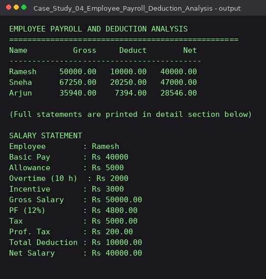

# 4. Employee Payroll and Deduction Analysis

**Student:** Leela Deepak Golukonda  |  **Roll No:** 26000521


## Problem Statement

Calculate gross salary from basic pay, allowances, overtime and incentives; apply progressive deductions; and generate a formatted salary statement.

## Objectives

- Compute gross salary from all earning components.
- Apply PF, progressive tax and professional tax.
- Produce a net salary for each employee.
- Print one detailed formatted salary statement.

## Assumptions

- Gross = basic + allowance + (overtime_hours * overtime_rate) + incentive.
- PF = 12% of basic pay.
- Tax = 20% of gross if gross > 50000 else 10%.
- Professional tax = Rs 200 flat.
- Net = gross - (PF + tax + prof tax).

## Algorithm

1. START.
2. FOR each employee tuple:
3.   gross = basic + allowance + ot_hours*ot_rate + incentive.
4.   pf = 12% of basic.
5.   tax = 20% of gross if gross>50000 else 10%.
6.   prof_tax = 200.
7.   deduction = pf + tax + prof_tax.
8.   net = gross - deduction.
9.   PRINT summary row.
10. PRINT a detailed statement for the first employee.
11. STOP.

## Flowchart

```
        +------------------+
        |      START       |
        +--------+---------+
                 |
        +--------v---------+
        | Read employee    |
        | tuples           |
        +--------+---------+
                 |
        +--------v---------+
        | gross = basic+   |
        | allow+ot+inc    |
        +--------+---------+
                 |
        +--------v---------+
        | pf=12%basic     |
        | tax=10/20%gross |
        | ptax=200        |
        +--------+---------+
                 |
        +--------v---------+
        | net = gross -   |
        | deductions      |
        +--------+---------+
                 |
        +--------v---------+
        | Print row & one |
        | detailed stmt   |
        +--------+---------+
                 |
        +--------v----+
                 | STOP   |
                 +--------+
```

## Pseudocode

```
BEGIN PayrollAnalysis
  employees = list of (name, basic, allow, otH, otR, inc)
  PRINT header
  FOR (name, basic, allow, otH, otR, inc) IN employees:
    gross = basic + allow + otH*otR + inc
    pf = basic * 0.12
    tax = gross*0.20 IF gross>50000 ELSE gross*0.10
    ptax = 200
    deduct = pf + tax + ptax
    net = gross - deduct
    PRINT name, gross, deduct, net
  PRINT detailed statement for employees[0]
END
```

## Python Source Code

```python
# Employee Payroll and Deduction Analysis
# Student: Leela Deepak Golukonda | Roll No: 26000521

print("EMPLOYEE PAYROLL AND DEDUCTION ANALYSIS")
print("=" * 50)

employees = [
    ("Ramesh", 40000, 5000, 10, 200, 3000),
    ("Sneha", 55000, 7000, 5, 250, 4000),
    ("Arjun", 30000, 3000, 8, 180, 1500),
]
# (name, basic, allowance, ot_hours, ot_rate, incentive)

print("%-8s %10s %10s %10s" % ("Name", "Gross", "Deduct", "Net"))
print("-" * 42)
for (name, basic, allw, ot, otr, inc) in employees:
    gross = basic + allw + ot * otr + inc
    pf = basic * 0.12
    if gross > 50000:
        tax = gross * 0.20
    else:
        tax = gross * 0.10
    ptax = 200
    deduct = pf + tax + ptax
    net = gross - deduct
    print("%-8s %10.2f %10.2f %10.2f" % (name, gross, deduct, net))

print("\n(Full statements are printed in detail section below)")
(name, basic, allw, ot, otr, inc) = employees[0]
gross = basic + allw + ot * otr + inc
pf = basic * 0.12
tax = gross * 0.20 if gross > 50000 else gross * 0.10
ptax = 200
deduct = pf + tax + ptax
net = gross - deduct
print("\nSALARY STATEMENT")
print("Employee        :", name)
print("Basic Pay       : Rs", basic)
print("Allowance       : Rs", allw)
print("Overtime (%d h)  : Rs %d" % (ot, ot * otr))
print("Incentive       : Rs", inc)
print("Gross Salary    : Rs %.2f" % gross)
print("PF (12%%)        : Rs %.2f" % pf)
print("Tax             : Rs %.2f" % tax)
print("Prof. Tax       : Rs %.2f" % ptax)
print("Total Deduction : Rs %.2f" % deduct)
print("Net Salary      : Rs %.2f" % net)

```

## Test Cases

| # | Input / Scenario | Expected Result |
|---|------------------|-----------------|
| 1 | Ramesh: basic 40000, gross 47500 | Tax 10%, net computed |
| 2 | Sneha: gross 59500 (>50000) | Tax 20% applied |
| 3 | Arjun: smallest earnings | Lowest net salary |
| 4 | Detailed statement totals | Gross - deductions = net |

## Output

```
EMPLOYEE PAYROLL AND DEDUCTION ANALYSIS
==================================================
Name          Gross     Deduct        Net
------------------------------------------
Ramesh     50000.00   10000.00   40000.00
Sneha      67250.00   20250.00   47000.00
Arjun      35940.00    7394.00   28546.00

(Full statements are printed in detail section below)

SALARY STATEMENT
Employee        : Ramesh
Basic Pay       : Rs 40000
Allowance       : Rs 5000
Overtime (10 h)  : Rs 2000
Incentive       : Rs 3000
Gross Salary    : Rs 50000.00
PF (12%)        : Rs 4800.00
Tax             : Rs 5000.00
Prof. Tax       : Rs 200.00
Total Deduction : Rs 10000.00
Net Salary      : Rs 40000.00

```



## Conclusion

The payroll logic combines arithmetic operators with conditional tax slabs. Tuple unpacking kept each employee's fields readable and the formatted statement is easy to audit.
