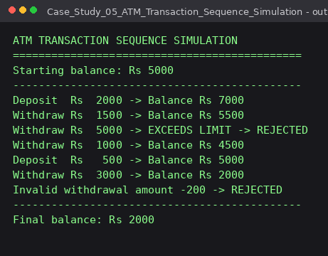

# 5. ATM Transaction Sequence Simulation

**Student:** Leela Deepak Golukonda  |  **Roll No:** 26000521


## Problem Statement

Process a sequence of deposits and withdrawals, maintain a simulated balance, enforce a withdrawal limit, reject invalid transactions, and produce a transaction summary.

## Objectives

- Maintain a running balance across a transaction list.
- Enforce a per-transaction withdrawal limit.
- Reject invalid amounts and insufficient funds.
- Print a final summary with the closing balance.

## Assumptions

- Starting balance = Rs 5000.
- Withdrawal limit per transaction = Rs 4000.
- Deposit/withdrawal amounts must be positive.
- Withdrawal cannot exceed current balance.
- Transactions are (type, amount) tuples: type in 'deposit'/'withdraw'.

## Algorithm

1. START.
2. Set balance = 5000, limit = 4000.
3. FOR each (type, amount) in transactions:
4.   IF type == 'deposit':
5.     IF amount <= 0 -> reject; ELSE balance += amount.
6.   ELSE IF type == 'withdraw':
7.     IF amount <= 0 -> reject.
8.     ELSE IF amount > limit -> reject (exceeds limit).
9.     ELSE IF amount > balance -> reject (insufficient).
10.     ELSE balance -= amount.
11.   ELSE reject unknown type.
12. PRINT final balance.
13. STOP.

## Flowchart

```
        +------------------+
        |      START       |
        +--------+---------+
                 |
        +--------v---------+
        | balance=5000     |
        | limit=4000       |
        +--------+---------+
                 |
        +--------v---------+
        | FOR each         |
        | transaction      |
        +--------+---------+
                 |
        +--------v---------+
        | type == deposit? |
        +--+--------+------+
       YES        NO
        |          |
   +----v---+  +---v-------------+
   |amount>0|  | type==withdraw? |
   |add     |  +--+----------+---+
   +----+---+   YES         NO
        |        |           |
        |   +----v---+   +---v---+
        |   |check    |   |reject |
        |   |limit/   |   |unknown|
        |   |balance  |   +---+---+
        |   +----+---+       |
        |        |           |
        +--------v-----------v---+
                 | PRINT final
                 +--------v----+
                          | STOP
                          +-----+
```

## Pseudocode

```
BEGIN ATM_Simulation
  balance = 5000; limit = 4000
  transactions = list of (type, amount)
  PRINT starting balance
  FOR (type, amount) IN transactions:
    IF type == 'deposit':
      IF amount <= 0: PRINT 'reject'; CONTINUE
      balance = balance + amount
    ELSE IF type == 'withdraw':
      IF amount <= 0: reject; CONTINUE
      IF amount > limit: reject 'exceeds limit'; CONTINUE
      IF amount > balance: reject 'insufficient'; CONTINUE
      balance = balance - amount
    ELSE: reject 'unknown'
    PRINT type, amount, balance
  PRINT final balance
END
```

## Python Source Code

```python
# ATM Transaction Sequence Simulation
# Student: Leela Deepak Golukonda | Roll No: 26000521

print("ATM TRANSACTION SEQUENCE SIMULATION")
print("=" * 45)

balance = 5000
WITHDRAW_LIMIT = 4000
transactions = [
    ("deposit", 2000),
    ("withdraw", 1500),
    ("withdraw", 5000),   # exceeds limit -> reject
    ("withdraw", 1000),
    ("deposit", 500),
    ("withdraw", 3000),
    ("withdraw", -200),   # invalid
]

print("Starting balance: Rs", balance)
print("-" * 45)
for (t, amt) in transactions:
    if t == "deposit":
        if amt <= 0:
            print("Invalid deposit amount", amt, "-> REJECTED")
            continue
        balance = balance + amt
        print("Deposit  Rs %5d -> Balance Rs %d" % (amt, balance))
    elif t == "withdraw":
        if amt <= 0:
            print("Invalid withdrawal amount", amt, "-> REJECTED")
            continue
        if amt > WITHDRAW_LIMIT:
            print("Withdraw Rs %5d -> EXCEEDS LIMIT -> REJECTED" % amt)
            continue
        if amt > balance:
            print("Withdraw Rs %5d -> INSUFFICIENT FUNDS -> REJECTED" % amt)
            continue
        balance = balance - amt
        print("Withdraw Rs %5d -> Balance Rs %d" % (amt, balance))
    else:
        print("Unknown transaction", t, "-> REJECTED")

print("-" * 45)
print("Final balance: Rs", balance)

```

## Test Cases

| # | Input / Scenario | Expected Result |
|---|------------------|-----------------|
| 1 | deposit 2000 | Balance 7000 |
| 2 | withdraw 5000 (>limit) | REJECTED (exceeds limit) |
| 3 | withdraw -200 (invalid) | REJECTED (invalid) |
| 4 | Sequence end | Final balance correct |

## Output

```
ATM TRANSACTION SEQUENCE SIMULATION
=============================================
Starting balance: Rs 5000
---------------------------------------------
Deposit  Rs  2000 -> Balance Rs 7000
Withdraw Rs  1500 -> Balance Rs 5500
Withdraw Rs  5000 -> EXCEEDS LIMIT -> REJECTED
Withdraw Rs  1000 -> Balance Rs 4500
Deposit  Rs   500 -> Balance Rs 5000
Withdraw Rs  3000 -> Balance Rs 2000
Invalid withdrawal amount -200 -> REJECTED
---------------------------------------------
Final balance: Rs 2000

```



## Conclusion

The simulation maintains state with a single balance variable and validates each step with guard conditions. It mirrors how a real ATM validates a transaction stream.
