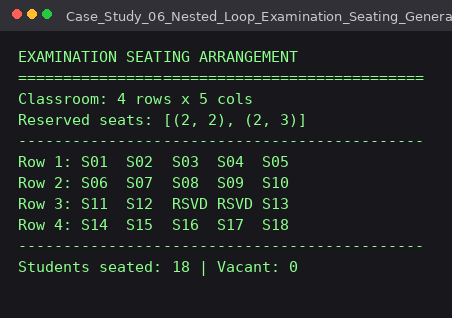

# 6. Nested Loop Examination Seating Generator

**Student:** Leela Deepak Golukonda  |  **Roll No:** 26000521


## Problem Statement

Generate a seating arrangement with row and column identifiers, reserved positions and fixed classroom capacity using nested loops.

## Objectives

- Build a 2D seating grid with nested loops.
- Mark reserved seats separately.
- Assign student identifiers until the list is exhausted.
- Report seated and vacant counts.

## Assumptions

- Classroom has 4 rows x 5 columns.
- Reserved seats are given as (row, col) zero-indexed tuples.
- Students are assigned sequentially S01, S02, ...
- Empty seats beyond students and reservations show '----'.

## Algorithm

1. START.
2. Define rows, cols, student list and reserved list.
3. Create an empty seating matrix.
4. FOR r in rows:
5.   FOR c in cols:
6.     IF (r,c) reserved -> place 'RSVD'.
7.     ELSE IF more students -> place next student id.
8.     ELSE -> place '----'.
9. PRINT the grid row by row.
10. PRINT seated and vacant counts.
11. STOP.

## Flowchart

```
        +------------------+
        |      START       |
        +--------+---------+
                 |
        +--------v---------+
        | rows, cols,      |
        | students, reserved|
        +--------+---------+
                 |
        +--------v---------+
        | FOR r = 0..rows  |
        +--------+---------+
                 |
        +--------v---------+
        |  FOR c = 0..cols |
        +--------+---------+
                 |
        +--------v---------+
        | (r,c) reserved?  |
        +--+--------+------+
       YES        NO
        |          |
   +----v---+  +---v-------------+
   |place   |  | more students?  |
   |'RSVD'  |  +--+----------+---+
   +----+---+   YES         NO
        |        |           |
        |   +----v---+   +---v---+
        |   |place    |   |place  |
        |   |student  |   |'----' |
        |   +----+----+   +---+---+
        |        |            |
        +--------v------------v---+
                 | PRINT grid
                 +--------v----+
                          | STOP
                          +-----+
```

## Pseudocode

```
BEGIN SeatingGenerator
  rows = 4; cols = 5
  students = ['S01'..'S20']
  reserved = [(2,2),(2,3)]
  seating = empty matrix rows x cols
  idx = 0
  FOR r = 0 TO rows-1:
    FOR c = 0 TO cols-1:
      IF (r,c) IN reserved: seating[r][c] = 'RSVD'
      ELSE IF idx < length(students):
        seating[r][c] = students[idx]; idx = idx+1
      ELSE: seating[r][c] = '----'
  PRINT seating, seated=idx, vacant = rows*cols - idx - len(reserved)
END
```

## Python Source Code

```python
# Nested Loop Examination Seating Generator
# Student: Leela Deepak Golukonda | Roll No: 26000521

print("EXAMINATION SEATING ARRANGEMENT")
print("=" * 45)

rows = 4
cols = 5
students = ["S01", "S02", "S03", "S04", "S05", "S06", "S07", "S08", "S09", "S10",
            "S11", "S12", "S13", "S14", "S15", "S16", "S17", "S18", "S19", "S20"]
reserved = [(2, 2), (2, 3)]  # reserved (row, col) zero-indexed

seating = []
idx = 0
for r in range(rows):
    rowseats = []
    for c in range(cols):
        if (r, c) in reserved:
            rowseats.append("RSVD")
        elif idx < len(students):
            rowseats.append(students[idx])
            idx += 1
        else:
            rowseats.append("----")
    seating.append(rowseats)

print("Classroom: %d rows x %d cols" % (rows, cols))
print("Reserved seats:", reserved)
print("-" * 45)
for r in range(rows):
    line = ""
    for c in range(cols):
        line = line + "%-5s" % seating[r][c]
    print("Row %d: " % (r + 1) + line)
print("-" * 45)
print("Students seated:", idx, "| Vacant:", rows * cols - idx - len(reserved))

```

## Test Cases

| # | Input / Scenario | Expected Result |
|---|------------------|-----------------|
| 1 | 4x5 grid, 20 students | All 20 seated, 0 vacant |
| 2 | Reserved (2,2),(2,3) | Marked RSVD |
| 3 | Beyond 20 students | Remaining seats '----' |
| 4 | Vacant count formula | rows*cols - seated - reserved |

## Output

```
EXAMINATION SEATING ARRANGEMENT
=============================================
Classroom: 4 rows x 5 cols
Reserved seats: [(2, 2), (2, 3)]
---------------------------------------------
Row 1: S01  S02  S03  S04  S05  
Row 2: S06  S07  S08  S09  S10  
Row 3: S11  S12  RSVD RSVD S13  
Row 4: S14  S15  S16  S17  S18  
---------------------------------------------
Students seated: 18 | Vacant: 0

```



## Conclusion

Nested loops naturally built the 2D seating matrix. Tuple membership made reserved-seat checking concise and the grid display was straightforward with formatted strings.
