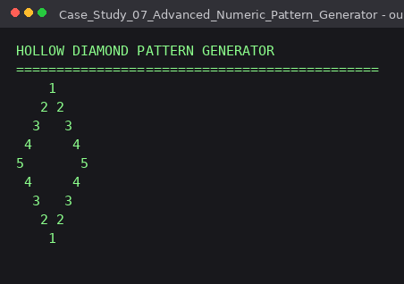

# 7. Advanced Numeric Pattern Generator (Hollow Diamond)

**Student:** Leela Deepak Golukonda  |  **Roll No:** 26000521


## Problem Statement

Produce a hollow diamond / symmetric numerical pattern based on a user-specified half-height, with validation for invalid dimensions and carefully aligned output.

## Objectives

- Validate that the dimension is a positive integer.
- Print the upper half of the hollow diamond.
- Print the lower half as a mirror image.
- Align numbers using leading spaces.

## Assumptions

- Input n is the half-height; total rows = 2n - 1.
- Only the first and last character of each row are printed (hollow).
- n must be >= 1; otherwise the pattern is invalid.
- Numbers printed equal the row's distance from the centre.

## Algorithm

1. START.
2. Read n (half-height).
3. IF n < 1 -> print invalid and stop.
4. FOR i = 1 to n (upper half):
5.   print (n-i) leading spaces.
6.   IF i == 1 print single number; ELSE print number, inner spaces, number.
7. FOR i = n-1 down to 1 (lower half):
8.   repeat the same row construction.
9. STOP.

## Flowchart

```
        +------------------+
        |      START       |
        +--------+---------+
                 |
        +--------v---------+
        | Read n (half-h)  |
        +--------+---------+
                 |
        +--------v---------+
        | n < 1 ?          |
        +--+--------+------+
       YES        NO
        |          |
   +----v---+  +---v------------------+
   |print   |  | FOR i=1..n (upper)   |
   |invalid |  | spaces + hollow row  |
   +----+---+  +---+-------------------+
        |          |
        |      +---v------------------+
        |      | FOR i=n-1..1 (lower) |
        |      | spaces + hollow row  |
        |      +---+-------------------+
        |          |
        +----------v----+
                 | STOP   |
                 +--------+
```

## Pseudocode

```
BEGIN HollowDiamond
  READ n
  IF n < 1: PRINT 'Invalid dimension'; STOP
  FOR i = 1 TO n:
    spaces = ' ' * (n - i)
    IF i == 1: row = '1'
    ELSE: row = str(i) + ' '*(2*i-3) + str(i)
    PRINT spaces + row
  FOR i = n-1 DOWNTO 1:
    spaces = ' ' * (n - i)
    IF i == 1: row = '1'
    ELSE: row = str(i) + ' '*(2*i-3) + str(i)
    PRINT spaces + row
END
```

## Python Source Code

```python
# Advanced Numeric Pattern Generator (Hollow Diamond)
# Student: Leela Deepak Golukonda | Roll No: 26000521

print("HOLLOW DIAMOND PATTERN GENERATOR")
print("=" * 45)

n = 5   # half-height; total rows = 2n-1
if n < 1:
    print("Invalid dimension")
else:
    # upper half
    for i in range(1, n + 1):
        spaces = " " * (n - i)
        if i == 1:
            print(spaces + "1")
        else:
            nums = str(i) + " " * (2 * i - 3) + str(i)
            print(spaces + nums)
    # lower half
    for i in range(n - 1, 0, -1):
        spaces = " " * (n - i)
        if i == 1:
            print(spaces + "1")
        else:
            nums = str(i) + " " * (2 * i - 3) + str(i)
            print(spaces + nums)

```

## Test Cases

| # | Input / Scenario | Expected Result |
|---|------------------|-----------------|
| 1 | n = 5 | 9-row hollow diamond |
| 2 | n = 1 | Single '1' |
| 3 | n = 3 | 5-row small diamond |
| 4 | n = 0 (invalid) | Prints 'Invalid dimension' |

## Output

```
HOLLOW DIAMOND PATTERN GENERATOR
=============================================
    1
   2 2
  3   3
 4     4
5       5
 4     4
  3   3
   2 2
    1

```



## Conclusion

Pattern generation with nested loops and careful space calculation produced a symmetric hollow diamond. The validation guard keeps the program robust against bad input.
