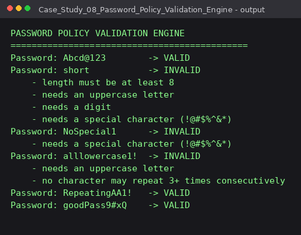

# 8. Password Policy Validation Engine

**Student:** Leela Deepak Golukonda  |  **Roll No:** 26000521


## Problem Statement

Evaluate sample password strings against minimum length, character-category, repetition and prohibited-substring rules; explain each failed condition.

## Objectives

- Check minimum length requirement.
- Verify presence of upper, lower, digit and special characters.
- Detect three or more consecutive repeated characters.
- Reject prohibited substrings and report all failures.

## Assumptions

- Minimum length = 8 characters.
- Must contain at least one uppercase, one lowercase, one digit.
- Special set = !@#$%^&* (at least one required).
- No character may repeat 3+ times consecutively.
- Substring 'password' (case-insensitive) is prohibited.

## Algorithm

1. START.
2. FOR each password in the list:
3.   Clear error list.
4.   Check length >= 8.
5.   Check upper, lower, digit presence via string methods.
6.   Check at least one special character.
7.   Scan for 3 consecutive identical characters.
8.   Check prohibited substring.
9.   PRINT valid/invalid and every failed rule.
10. STOP.

## Flowchart

```
        +------------------+
        |      START       |
        +--------+---------+
                 |
        +--------v---------+
        | FOR each password|
        +--------+---------+
                 |
        +--------v---------+
        | errors = empty   |
        +--------+---------+
                 |
        +--------v---------+
        | len>=8? upper?   |
        | lower? digit?    |
        | special? repeat? |
        | prohibited?      |
        +--------+---------+
                 |
        +--------v---------+
        | errors empty?    |
        +--+--------+------+
       YES        NO
        |          |
   +----v---+  +---v-----------+
   |PRINT   |  | PRINT each    |
   |VALID   |  | failed rule   |
   +----+---+  +---+-----------+
        |          |
        +----------v----+
                 | STOP   |
                 +--------+
```

## Pseudocode

```
BEGIN PasswordValidation
  passwords = list of strings
  specials = '!@#$%^&*'
  FOR pw IN passwords:
    errors = []
    IF length(pw) < 8: errors += 'length'
    IF no uppercase in pw: errors += 'upper'
    IF no lowercase in pw: errors += 'lower'
    IF no digit in pw: errors += 'digit'
    IF no char of specials in pw: errors += 'special'
    FOR i = 0 TO length(pw)-3:
      IF pw[i]==pw[i+1]==pw[i+2]: errors += 'repeat'
    IF 'password' in lower(pw): errors += 'prohibited'
    IF errors empty: PRINT pw, 'VALID'
    ELSE: PRINT pw, 'INVALID' and each error
END
```

## Python Source Code

```python
# Password Policy Validation Engine
# Student: Leela Deepak Golukonda | Roll No: 26000521

print("PASSWORD POLICY VALIDATION ENGINE")
print("=" * 45)

passwords = ["Abcd@123", "short", "NoSpecial1", "alllowercase1!", "RepeatingAA1!", "goodPass9#xQ"]

for pw in passwords:
    errors = []
    if len(pw) < 8:
        errors.append("length must be at least 8")
    if not any(ch.isupper() for ch in pw):
        errors.append("needs an uppercase letter")
    if not any(ch.islower() for ch in pw):
        errors.append("needs a lowercase letter")
    if not any(ch.isdigit() for ch in pw):
        errors.append("needs a digit")
    specials = "!@#$%^&*"
    if not any(ch in specials for ch in pw):
        errors.append("needs a special character (!@#$%^&*)")
    rep = False
    for i in range(len(pw) - 2):
        if pw[i] == pw[i + 1] == pw[i + 2]:
            rep = True
    if rep:
        errors.append("no character may repeat 3+ times consecutively")
    if "password" in pw.lower():
        errors.append("contains prohibited word 'password'")
    print("Password: %-15s -> %s" % (pw, "VALID" if not errors else "INVALID"))
    for e in errors:
        print("    - " + e)

```

## Test Cases

| # | Input / Scenario | Expected Result |
|---|------------------|-----------------|
| 1 | Abcd@123 | VALID (all rules met) |
| 2 | short | INVALID (too short) |
| 3 | NoSpecial1 | INVALID (no special char) |
| 4 | RepeatingAA1! | INVALID (3x 'A' repeat) |

## Output

```
PASSWORD POLICY VALIDATION ENGINE
=============================================
Password: Abcd@123        -> VALID
Password: short           -> INVALID
    - length must be at least 8
    - needs an uppercase letter
    - needs a digit
    - needs a special character (!@#$%^&*)
Password: NoSpecial1      -> INVALID
    - needs a special character (!@#$%^&*)
Password: alllowercase1!  -> INVALID
    - needs an uppercase letter
    - no character may repeat 3+ times consecutively
Password: RepeatingAA1!   -> VALID
Password: goodPass9#xQ    -> VALID

```



## Conclusion

The engine demonstrates powerful string methods (any/isupper/islower/isdigit) and a simple sliding check for repeats. Reporting every failure makes it a useful learning tool.
