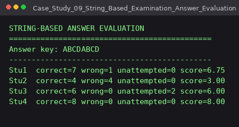

# 9. String-Based Examination Answer Evaluation

**Student:** Leela Deepak Golukonda  |  **Roll No:** 26000521


## Problem Statement

Compare answer strings against an answer key, calculate correct, incorrect and unanswered responses, apply negative marking, and produce student-wise results.

## Objectives

- Align each student's answer string with the answer key.
- Count correct, wrong and unanswered responses.
- Apply negative marking for wrong answers.
- Report a score per student.

## Assumptions

- Answer key is a string of A/B/C/D; space means unattempted.
- Student answers are strings of equal or shorter length; missing treated as space.
- Correct = +1, Wrong = -0.25 (negative marking).
- Unanswered contributes 0.

## Algorithm

1. START.
2. Define key string.
3. FOR each (name, answer) in students:
4.   Pad answer to key length with spaces.
5.   FOR each position i:
6.     IF answer[i] == ' ' -> unattempted.
7.     ELSE IF answer[i] == key[i] -> correct.
8.     ELSE -> wrong.
9.   score = correct - wrong * 0.25.
10.   PRINT student summary.
11. STOP.

## Flowchart

```
        +------------------+
        |      START       |
        +--------+---------+
                 |
        +--------v---------+
        | key = answer key|
        +--------+---------+
                 |
        +--------v---------+
        | FOR each student|
        +--------+---------+
                 |
        +--------v---------+
        | pad answer to   |
        | key length      |
        +--------+---------+
                 |
        +--------v---------+
        | FOR each position|
        | space/correct/   |
        | wrong ?          |
        +--------+---------+
                 |
        +--------v---------+
        | score = correct |
        | - wrong*0.25    |
        +--------+---------+
                 |
        +--------v----+
                 | STOP   |
                 +--------+
```

## Pseudocode

```
BEGIN AnswerEvaluation
  key = 'ABCDABCD'
  students = list of (name, answers)
  NEG = 0.25
  PRINT key
  FOR (name, ans) IN students:
    ans = pad(ans, length(key), ' ')
    correct = wrong = unattempt = 0
    FOR i = 0 TO length(key)-1:
      IF ans[i] == ' ': unattempt = unattempt + 1
      ELSE IF ans[i] == key[i]: correct = correct + 1
      ELSE: wrong = wrong + 1
    score = correct - wrong * NEG
    PRINT name, correct, wrong, unattempt, score
END
```

## Python Source Code

```python
# String-Based Examination Answer Evaluation
# Student: Leela Deepak Golukonda | Roll No: 26000521

print("STRING-BASED ANSWER EVALUATION")
print("=" * 45)

key = "ABCDABCD"   # answer key (A/B/C/D/space for unattempted)
students = [
    ("Stu1", "ABCDABCA"),
    ("Stu2", "ABCABCDD"),
    ("Stu3", "AB DAB D"),
    ("Stu4", "ABCDABCD"),
]
NEG = 0.25
print("Answer key:", key)
print("-" * 45)
for (name, ans) in students:
    correct = 0
    wrong = 0
    unattempt = 0
    ans = (ans + " " * len(key))[:len(key)]
    for i in range(len(key)):
        k = key[i]
        a = ans[i]
        if a == " ":
            unattempt += 1
        elif a == k:
            correct += 1
        else:
            wrong += 1
    score = correct - wrong * NEG
    score = round(score, 2)
    print("%-5s correct=%d wrong=%d unattempted=%d score=%.2f" % (name, correct, wrong, unattempt, score))

```

## Test Cases

| # | Input / Scenario | Expected Result |
|---|------------------|-----------------|
| 1 | Stu4 answers exactly key | score 8.00 (all correct) |
| 2 | Stu3 leaves two blank | 2 unanswered, no negative |
| 3 | One wrong answer | score reduced by 0.25 |
| 4 | Padded short answer | Missing = unattempted |

## Output

```
STRING-BASED ANSWER EVALUATION
=============================================
Answer key: ABCDABCD
---------------------------------------------
Stu1  correct=7 wrong=1 unattempted=0 score=6.75
Stu2  correct=4 wrong=4 unattempted=0 score=3.00
Stu3  correct=6 wrong=0 unattempted=2 score=6.00
Stu4  correct=8 wrong=0 unattempted=0 score=8.00

```



## Conclusion

Index-wise string comparison with the answer key produced accurate counts. Tuple unpacking made the student loop clean and negative marking was applied with simple arithmetic.
