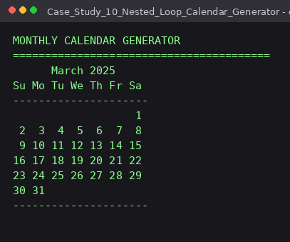

# 10. Nested Loop Calendar Generator

**Student:** Leela Deepak Golukonda  |  **Roll No:** 26000521


## Problem Statement

Generate a formatted monthly calendar using the supplied starting weekday and number of days, correctly aligning weeks and handling valid month lengths.

## Objectives

- Render weekday headers (Sun..Sat).
- Place leading blanks for the starting weekday.
- Print day numbers in rows of seven using nested loops.
- Handle the final partial week.

## Assumptions

- Week starts on Sunday (0=Sun ... 6=Sat).
- March 2025 starts on Saturday (start_weekday = 6).
- Days in month = 31.
- Each cell is right-aligned in a 2-character field.

## Algorithm

1. START.
2. Set month name, year, start_weekday, days_in_month.
3. PRINT title and weekday header.
4. Print start_weekday leading blank cells.
5. FOR day = 1 to days_in_month:
6.   PRINT day in a cell.
7.   IF (start_weekday + day) % 7 == 0 -> new line (week complete).
8. PRINT any remaining partial week.
9. STOP.

## Flowchart

```
        +------------------+
        |      START       |
        +--------+---------+
                 |
        +--------v---------+
        | month, year,     |
        | start_wd, days   |
        +--------+---------+
                 |
        +--------v---------+
        | print title &    |
        | weekday header   |
        +--------+---------+
                 |
        +--------v---------+
        | print leading    |
        | blank cells      |
        +--------+---------+
                 |
        +--------v---------+
        | FOR day=1..days: |
        | print cell; if    |
        | (start+day)%7==0  |
        | new line          |
        +--------+---------+
                 |
        +--------v---------+
        | print remaining   |
        | partial week      |
        +--------+---------+
                 |
        +--------v----+
                 | STOP   |
                 +--------+
```

## Pseudocode

```
BEGIN CalendarGenerator
  month='March'; year=2025; start_wd=6; days=31
  PRINT title, 'Su Mo Tu We Th Fr Sa'
  line = '' 
  FOR i = 0 TO start_wd-1: line = line + '   '
  FOR day = 1 TO days:
    line = line + right_pad(day,2) + ' '
    IF (start_wd + day) % 7 == 0:
      PRINT line; line = ''
  IF line != '': PRINT line
END
```

## Python Source Code

```python
# Nested Loop Calendar Generator
# Student: Leela Deepak Golukonda | Roll No: 26000521

print("MONTHLY CALENDAR GENERATOR")
print("=" * 40)

month_name = "March"
year = 2025
start_weekday = 6   # 0=Sun ... 6=Sat (March 2025 starts on Saturday)
days_in_month = 31

print("      %s %d" % (month_name, year))
print("Su Mo Tu We Th Fr Sa")
print("-" * 21)
line = ""
for i in range(start_weekday):
    line = line + "   "
for day in range(1, days_in_month + 1):
    line = line + "%2d " % day
    if (start_weekday + day) % 7 == 0:
        print(line)
        line = ""
if line != "":
    print(line)
print("-" * 21)

```

## Test Cases

| # | Input / Scenario | Expected Result |
|---|------------------|-----------------|
| 1 | March 2025, start Sat | 1st placed in Saturday column |
| 2 | Leading blanks = 6 | Sun..Fri blank before 1 |
| 3 | Day 8 wraps row | New week starts at 2 |
| 4 | Final partial week | 30 31 printed on last line |

## Output

```
MONTHLY CALENDAR GENERATOR
========================================
      March 2025
Su Mo Tu We Th Fr Sa
---------------------
                   1 
 2  3  4  5  6  7  8 
 9 10 11 12 13 14 15 
16 17 18 19 20 21 22 
23 24 25 26 27 28 29 
30 31 
---------------------

```



## Conclusion

The calendar combined a leading-blank prefix with a single counting loop and a week-wrap condition. Nested reasoning (week position modulo 7) produced correct alignment without OOP.
